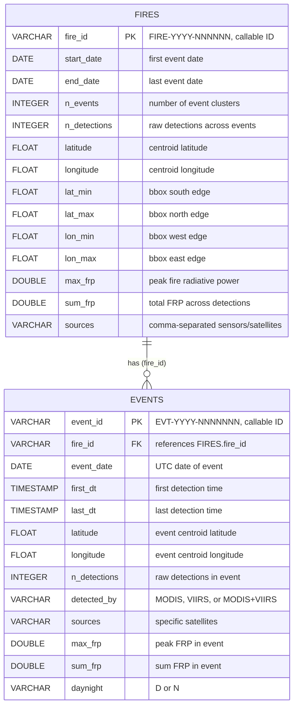
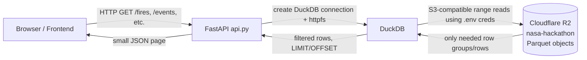

# Wildfire API & Data ERD

This document describes the **current state** of the slim unified wildfire dataset and how the API serves it.

## Current data state

- **Dataset**: `data/unified_slim/` (local) and mirrored to Cloudflare R2 bucket `nasa-hackathon`
- **Format**: Parquet (ZSTD level 19, row group size 200000), partitioned by year
- **Total size**: ~4.1 GB (`events` 2.38 GB + `fires` 1.76 GB)
- **Rows**: `events` 164,025,421; `fires` 60,445,399
- **Coverage**: 2000–2026 (2025/2026 partial depending on source coverage)
- **Sensors**: MODIS Terra/Aqua + VIIRS SNPP/NOAA-20/NOAA-21 (harmonized into one dataset)
- **Precision note**: coordinates and bbox stored as `FLOAT` (float32, ~1 m precision, sufficient for 375 m–1 km pixels); FRP kept as `DOUBLE`

### Storage layout (R2 / local)

```text
nasa-hackathon/                  data/unified_slim/
├── events/                      ├── events/
│   ├── events_2000.parquet      │   ├── events_2000.parquet
│   └── ... events_2026.parquet  │   └── ... events_2026.parquet
├── fires/                       ├── fires/
│   ├── fires_2000.parquet       │   ├── fires_2000.parquet
│   └── ... fires_2026.parquet   │   └── ... fires_2026.parquet
├── build_manifest.json          ├── build_manifest.json
└── validation_report.json       ├── wildfire.duckdb (local view catalog)
                                 └── samples/, provenance_old/
```

R2 is **object storage** (S3-compatible). It stores files, not SQL tables. The API queries Parquet objects directly via DuckDB `httpfs`.

## ER diagram



### Relationship

- **Cardinality**: one `FIRES` row → zero-to-many `EVENTS` rows.
- **Join key**: `events.fire_id = fires.fire_id` (real foreign-key relationship for RDBMS use; enforced by the builder/catalog logic, not by Parquet itself).
- **Grain**:
  - `fires` = persistent fire incident summary (primary API list).
  - `events` = near-simultaneous observation cluster / daily drill-down.
- **bbox** (`lat_min/lat_max/lon_min/lon_max`): smallest rectangle around a fire’s event points. Useful for map zoom/footprint and coarse spatial filtering. **Not** burned area or perimeter.

## How the API works

`api.py` is a FastAPI service that reads the slim Parquet files from R2 and returns small JSON pages to clients (e.g. `frontend/index.html`). It never sends the 4 GB dataset to the browser.



### Request flow

1. **Client request**: frontend or API consumer calls an endpoint with filters (`year`, `lat/lon/radius_km`, `bbox`, `from`/`to`, `limit`, `offset`).
2. **API handler** (`api.py`): validates params, builds a SQL `WHERE` clause with parameterized values, and selects the target Parquet path:
   - with `year`: `s3://nasa-hackathon/fires/fires_{year}.parquet` (one file)
   - without `year`: `s3://nasa-hackathon/fires/fires_*.parquet` (all years; slower, avoid when possible)
3. **DuckDB + httpfs**: loads `httpfs`, configures R2 credentials from `.env` (`access_key`, `secret_key`, `s3_endpoint`), runs `read_parquet(...)` against R2.
4. **Predicate pushdown / streaming**: DuckDB reads Parquet metadata/row groups and fetches only what it needs for the filter; it does **not** load the full 4 GB into RAM.
5. **Response**: API returns a small JSON payload (e.g. `{ "count": N, "results": [...] }` for list endpoints, or a single object for ID lookups).

### Endpoints

| Method | Path | Purpose | Key params |
| --- | --- | --- | --- |
| GET | `/` | Serves `frontend/index.html` if present | — |
| GET | `/health` | Health/bucket check | — |
| GET | `/years` | Per-year fire/event counts (scans year files) | — |
| GET | `/fires` | Paged fire list | `year`, `lat`, `lon`, `radius_km`, `bbox=minLat,minLon,maxLat,maxLon`, `from`, `to`, `limit` (≤5000), `offset` |
| GET | `/fires/{fire_id}` | One fire by ID | routes by year parsed from `FIRE-YYYY-*` |
| GET | `/fires/{fire_id}/events` | Drill-down events for a fire | `limit` (≤10000) |
| GET | `/events` | Paged event list | `year`, `bbox`, `from`, `to`, `limit`, `offset` |
| GET | `/events/{event_id}` | One event by ID | routes by year parsed from `EVT-YYYY-*` |

### Query and performance behavior

- **Pagination**: list endpoints always use `LIMIT`/`OFFSET`; caps prevent huge responses.
- **Spatial search**: `lat/lon/radius_km` is converted to a bbox (`delta_lat = radius/111`, longitude adjusted by latitude) and filtered with `latitude/longitude BETWEEN ...`.
- **Date search**: `from`/`to` map to `start_date` (fires) or `event_date` (events).
- **ID lookups**: parse the year from the ID and try that year’s file first, then fall back to all files if needed.
- **RAM/transfer**: browser receives only page-sized JSON; server uses DuckDB streaming + limits. For production, add connection reuse/pooling, response compression (gzip), caching, and stricter rate limits.
- **CORS**: enabled for all origins in the current demo (`api.py`); restrict in production.

### Frontend interaction (`frontend/index.html`)

- User enters **location** (text geocoded via Nominatim or `lat,lon`), **date range**, **radius**, optional **year**.
- Frontend calls `/fires` with spatial/date filters and renders pins on an OpenStreetMap/Leaflet map.
- A modal lists matching fires; selecting a fire calls `/fires/{fire_id}` and `/fires/{fire_id}/events` for detail + timeline.
- The UI is brutal-minimalist (black backdrop, star-field particles, high contrast); the full dataset is never loaded client-side.

## Run

```bash
python3 -m uvicorn api:app --host 0.0.0.0 --port 8000
```

Requires `.env` with `access_key`, `secret_key`, `s3_endpoint` (and optional `token`) for R2 access. Keep `.env` out of git.
